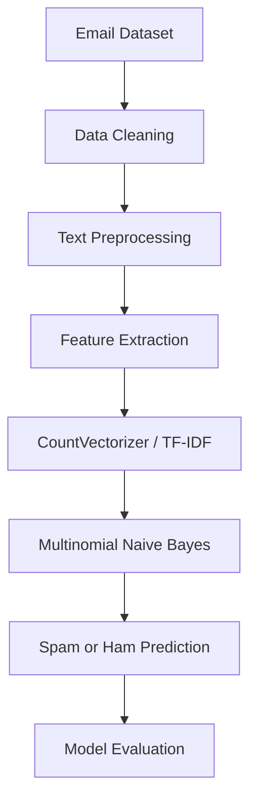

# 📧 Email Spam Detection System

A Machine Learning project that classifies email messages as **Spam** or **Ham (Legitimate Email)** using Natural Language Processing (NLP) and the Multinomial Naive Bayes algorithm.

The project demonstrates how text data can be transformed into numerical features and used to train a supervised machine learning classifier for automated spam detection.

## 🚀 Key Features

- **Spam Classification:** Categorizes email text as Spam or Ham.
- **Text Feature Extraction:** Converts email text into numerical features using CountVectorizer.
- **Multinomial Naive Bayes:** Applies a probabilistic machine learning algorithm for text classification.
- **Text Pattern Analysis:** Learns statistical patterns from labeled email examples.
- **Prediction Probabilities:** Can provide class probabilities when supported by the trained model.
- **Model Evaluation:** Supports evaluation using accuracy, precision, recall, F1-score, and ROC-AUC where implemented.
- **Reusable Model Pipeline:** Can combine vectorization and classification into a single Scikit-learn pipeline.
- **Extensible Design:** Provides a foundation for experimentation with alternative vectorizers and classification algorithms.

## 🧠 Machine Learning Workflow

The system follows a supervised text classification workflow.



### Workflow Explanation

1. **Data Collection:** Load a labeled dataset containing email messages and their spam/ham categories.
2. **Data Preparation:** Inspect the dataset, handle missing values, and prepare the target labels.
3. **Text Preprocessing:** Clean and normalize the text according to the implemented preprocessing steps.
4. **Feature Extraction:** Convert text into numerical features using a vectorization technique.
5. **Model Training:** Train a Multinomial Naive Bayes classifier on the training data.
6. **Model Testing:** Evaluate the model using unseen test samples.
7. **Prediction:** Classify new email messages using the fitted vectorizer and classifier.

## 🛠️ Technology Stack

| Category | Technologies |
|---|---|
| Programming Language | Python |
| Data Manipulation | Pandas, NumPy |
| Machine Learning | Scikit-learn |
| NLP Feature Extraction | CountVectorizer, TF-IDF (if implemented) |
| Classification Algorithm | Multinomial Naive Bayes |
| Visualization | Matplotlib, Seaborn (if implemented) |
| Text Visualization | WordCloud (if implemented) |
| Testing | Pytest (if tests are implemented) |
| Version Control | Git, GitHub |

## 📊 Model Evaluation

The current README reports the following performance values. **Verify them against the actual evaluation output before presenting them as final results.**

| Metric | Reported Score |
|---|---:|
| Accuracy | 97.5% |
| Precision | 96.8% |
| Recall | 95.9% |
| F1-Score | 96.3% |
| ROC-AUC | 0.989 |

### Evaluation Metrics Explained

- **Accuracy:** Percentage of emails classified correctly.
- **Precision:** Measures how many emails predicted as spam were actually spam.
- **Recall:** Measures how many actual spam emails were correctly detected.
- **F1-Score:** Balances precision and recall.
- **ROC-AUC:** Measures how well the model distinguishes between the two classes across different classification thresholds.

These scores depend on the dataset, train/test split, preprocessing pipeline, and evaluation method. They should not be treated as independently verified results until reproduced.

## ⚙️ Installation and Setup

### Prerequisites

- Python installed on your system
- Git
- pip package manager

### Step 1: Clone the repository

```bash
git clone https://github.com/venkatasuneel3015/Email-Spam-detection.git
```

### Step 2: Open the project directory

```bash
cd Email-Spam-detection
```

### Step 3: Create a virtual environment

**Windows:**

```bash
python -m venv venv
venv\Scripts\activate
```

**macOS/Linux:**

```bash
python -m venv venv
source venv/bin/activate
```

### Step 4: Install dependencies

```bash
python -m pip install --upgrade pip
pip install -r requirements.txt
```

### Step 5: Run the project

Follow the training or prediction instructions provided by the Python scripts or notebook included in the repository.

The exact execution command depends on the actual entry-point file. For example, use `python filename.py` only when that file exists and is designed to run directly.

## 💡 Example Classification

The following illustrates the intended classification behavior.

| Example Email | Expected Category |
|---|---|
| "Congratulations! You have won a free prize. Claim now!" | Spam |
| "Hi, our team meeting is scheduled for tomorrow at 10 AM." | Ham |
| "Limited-time offer! Click here to claim your reward." | Spam |
| "Please find the meeting notes attached." | Ham |

These are illustrative examples, not measured outputs from the trained model.

## 🔬 Model Details

### Multinomial Naive Bayes

Multinomial Naive Bayes is a probabilistic classification algorithm commonly used for text categorization. It estimates class probabilities from feature frequencies and applies Bayes' theorem to predict the most likely class.

The model is suitable for spam detection because email messages contain recurring words and patterns that can help distinguish unwanted messages from legitimate communication.

### Feature Extraction

**CountVectorizer** represents text using token occurrence counts. Alternatively, **TF-IDF** can represent words based on their relative importance within a document collection.

The vectorizer must be fitted on training data only and then reused unchanged for validation, testing, and new email predictions to avoid data leakage.

## 📁 Suggested Project Structure

The following is a recommended organization. Adjust it to match the files actually present in your repository.

```text
Email-Spam-detection/
├── data/
│   ├── raw/
│   └── processed/
├── models/
├── notebooks/
├── src/
│   ├── preprocessing.py
│   ├── detector.py
│   └── visualization.py
├── tests/
├── requirements.txt
├── README.md
└── .gitignore
```

## 🔐 Limitations and Responsible Use

- **Dataset dependence:** Performance depends on the quality and representativeness of the training data.
- **Changing spam patterns:** New spam tactics may reduce model effectiveness over time.
- **False positives:** Legitimate emails can sometimes be classified as spam.
- **False negatives:** Some spam messages may be classified as legitimate.
- **Language limitations:** Performance may vary for languages or writing styles not represented in the training data.
- **Privacy:** Avoid sending confidential email content to external services without appropriate authorization and safeguards.

The model should support email filtering decisions rather than be treated as a perfect spam detector.

## 🔮 Future Improvements

Potential enhancements include:

- Compare Multinomial Naive Bayes with Logistic Regression and Linear SVM.
- Compare CountVectorizer with TF-IDF feature extraction.
- Implement cross-validation and hyperparameter tuning.
- Add a confusion matrix and per-class evaluation report.
- Build an interactive web interface using Streamlit.
- Support batch classification of multiple emails.
- Add unit tests for preprocessing and prediction.
- Deploy the application to a suitable hosting platform.

These are proposed enhancements and should not be interpreted as existing features.

## 👨‍💻 Author

**Venkata Suneel R**

B.Tech in Artificial Intelligence & Data Science

- **GitHub:** https://github.com/venkatasuneel3015
- **LinkedIn:** https://www.linkedin.com/in/venkata-suneel-3b6679344/

## 📄 License

If this repository includes a `LICENSE` file, refer to that file for the applicable terms. Do not claim the project is MIT-licensed unless the repository actually contains a valid MIT license.

---

**Skills Demonstrated:** Python · Machine Learning · Natural Language Processing · Text Classification · Feature Engineering · Model Evaluation · Scikit-learn · Git & GitHub
